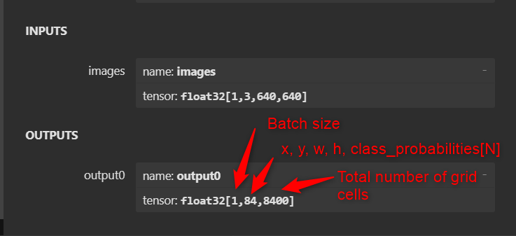
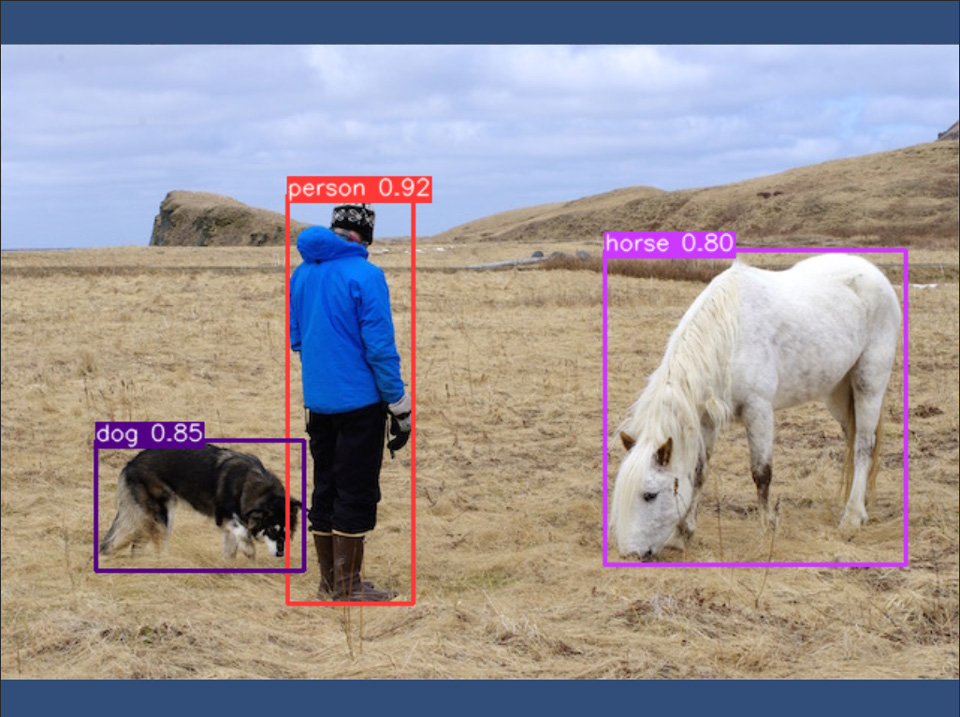
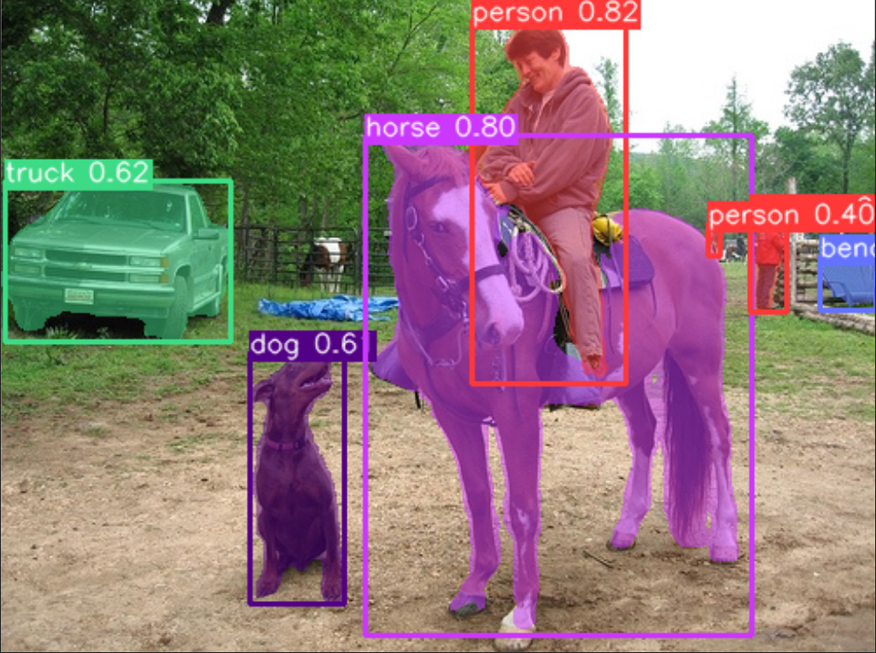
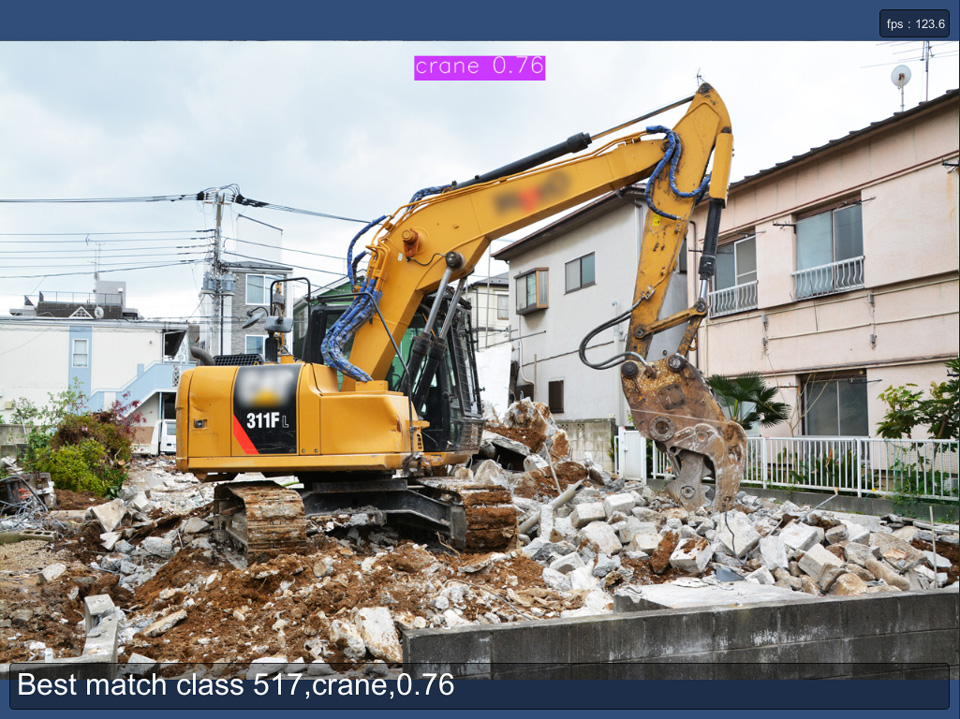
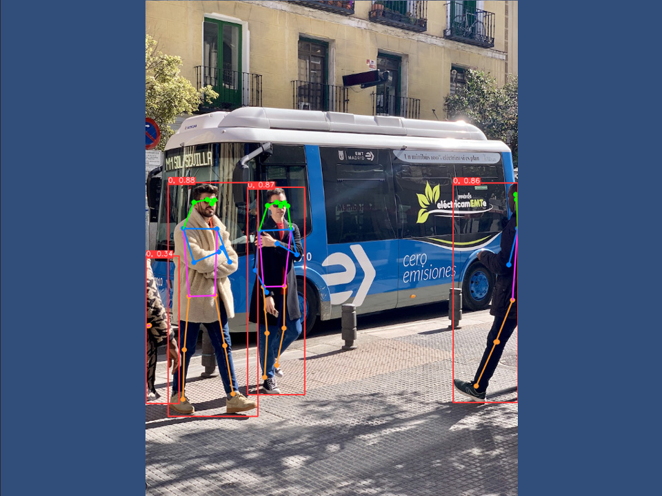

# YOLOv8 With OpenCVForUnity Example

> **Notice:** The YOLOv8 With OpenCVForUnity Example has been integrated into the **[OpenCV for Unity](https://assetstore.unity.com/packages/tools/integration/opencv-for-unity-21088?aid=1011l4ehR)** package.
>
> The example files are no longer distributed from this repository.
> The repository is now maintained as a distribution repository for **model files used by the examples**.
>
> The model files in this repository are **pretrained ONNX models distributed by [Ultralytics](https://github.com/ultralytics/ultralytics)**. These files are redistributed without modification under the applicable Ultralytics licenses. Please check the applicable license before using the models in your own applications.
>
> If you are looking for the YOLOv8 example itself, please use the examples included with OpenCVForUnity.

- An example of using OpenCV dnn module with YOLOv8. [https://docs.ultralytics.com/models/yolov8/](https://docs.ultralytics.com/models/yolov8/)
- This example can also work for [YOLOv5u](https://docs.ultralytics.com/models/yolov5/), [YOLOv9](https://docs.ultralytics.com/models/yolov9/), ~~[YOLOv10](https://docs.ultralytics.com/models/yolov10/)~~, [YOLOv11](https://docs.ultralytics.com/models/yolov11/), [YOLOv12](https://docs.ultralytics.com/models/yolov12/) models, which has the same input/output shapes as the YOLOv8 model.

 

## Training from custom data and export to ONNX
1. [YOLOv8_export_to_OpenCVDNN_ONNX](https://github.com/EnoxSoftware/YOLOv8WithOpenCVForUnityExample/tree/master/models/YOLOv8/)
1. [YOLOv5u_export_to_OpenCVDNN_ONNX](https://github.com/EnoxSoftware/YOLOv8WithOpenCVForUnityExample/tree/master/models/YOLOv5u/)
1. [YOLOv9_export_to_OpenCVDNN_ONNX](https://github.com/EnoxSoftware/YOLOv8WithOpenCVForUnityExample/tree/master/models/YOLOv9/)
1. [YOLOv10_export_to_OpenCVDNN_ONNX](https://github.com/EnoxSoftware/YOLOv8WithOpenCVForUnityExample/tree/master/models/YOLOv10/)
1. [YOLOv11_export_to_OpenCVDNN_ONNX](https://github.com/EnoxSoftware/YOLOv8WithOpenCVForUnityExample/tree/master/models/YOLOv11/)
1. [YOLOv12_export_to_OpenCVDNN_ONNX](https://github.com/EnoxSoftware/YOLOv8WithOpenCVForUnityExample/tree/master/models/YOLOv12/)

## Tutorials
1. [How to Train Ultralytics YOLOv8 models on Your Custom Dataset in Google Colab](https://www.youtube.com/watch?v=LNwODJXcvt4)

## Works with Multi-Object Tracking (MOT)
1. [MultiObjectTrackingExample](https://github.com/EnoxSoftware/OpenCVForUnity/tree/master/Assets/OpenCVForUnity/Examples/Advanced/MultiObjectTrackingExample)

## ScreenShot

